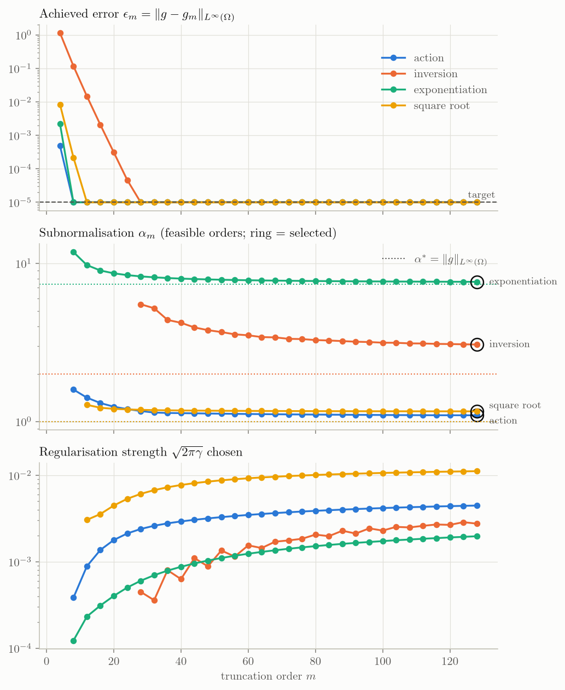
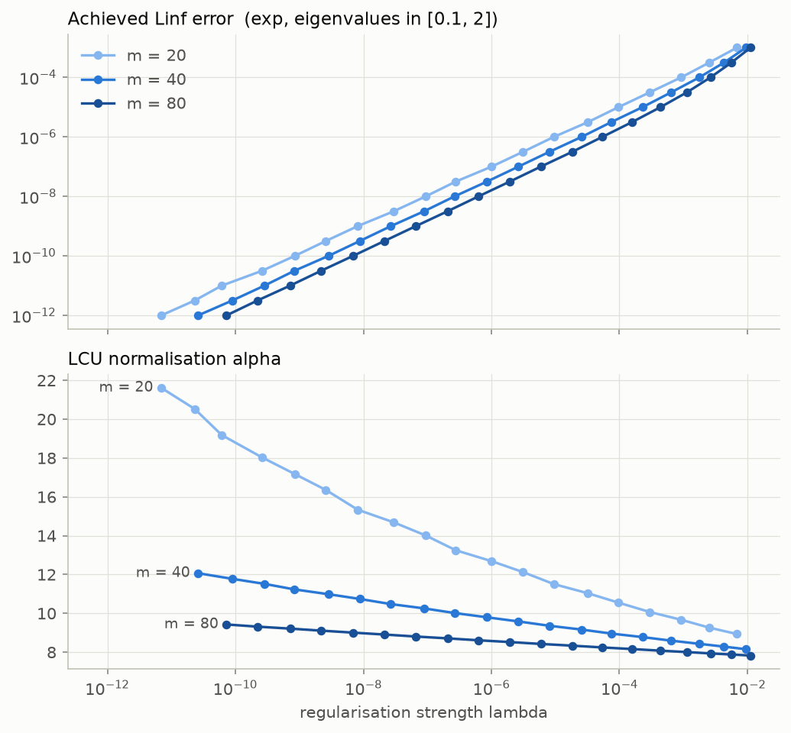
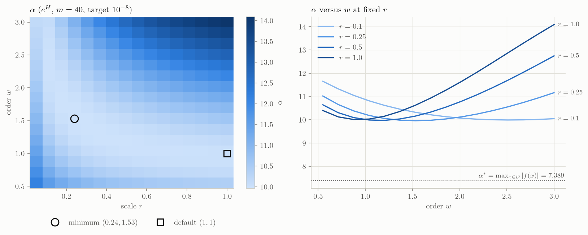
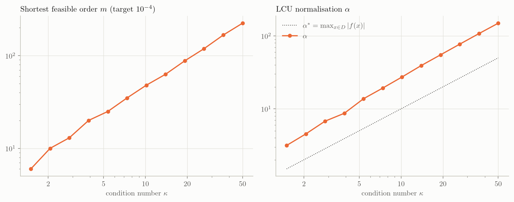
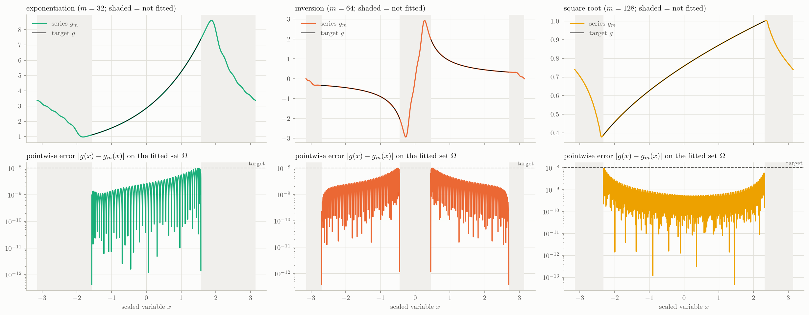
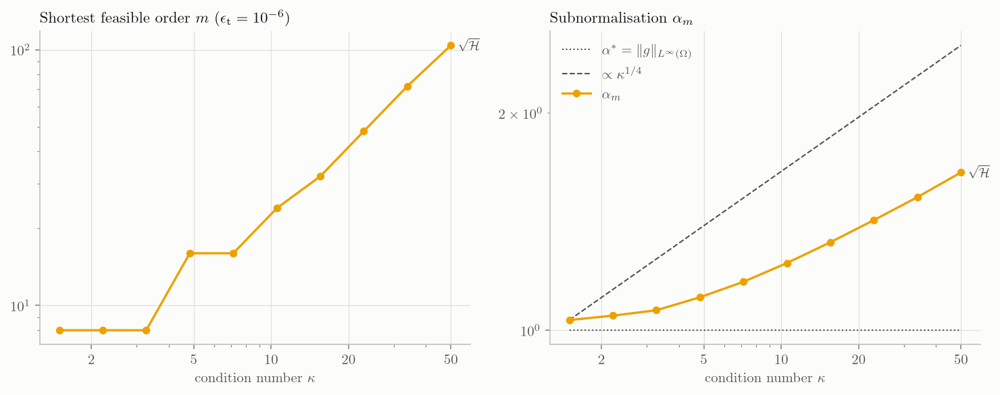
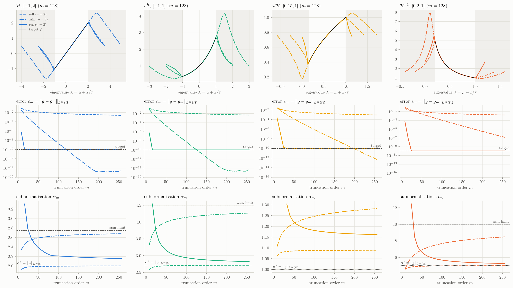

# Examples

Each script in `examples/` is short and self-contained, and shows one idea.
Run any of them from the project root:

```bash
python examples/action/01_basic_interval.py
```

!!! note
    The examples pass a short `m_values` range so most run in a few seconds.
    Make sure `felcu` is installed in editable mode (`pip install -e .`) so
    they use your working copy.

## Action

### Action on a symmetric interval

Fit \(f(\mathcal H) = \mathcal H\) for a Hermitian \(\mathcal H\) with
eigenvalues in \([-1, 1]\).

`felcu` centres the fit at \(\mu = 0\), the middle of the interval, and
fits \(g(x) = x/\tau\).  Because that is odd, every cosine coefficient
\(b_k\) and the constant term \(a_0\) vanish.

```python title="examples/action/01_basic_interval.py"
--8<-- "examples/action/01_basic_interval.py"
```

### Action on an off-centre interval

For eigenvalues in \([2, 5]\), `felcu` centres the fit at \(\mu = 3.5\):

\[
g(x) = \mu + \frac{x}{\tau}, \qquad f(\mathcal H) = g(\tau(\mathcal H - \mu I)),
\]

so the constant term carries \(\mu\) and only the half-width needs fitting.

\(\mathcal H\) is positive definite here, so its singular values are its
eigenvalues, and `spectral_kind='singular_values'` fits them through the
Hermitian dilation instead.  The dilation's spectrum,
\([-5, -2] \cup [2, 5]\), is centred at \(0\), so \(\mu = 0\) and the odd
\(g(x) = x/\tau\) covers the whole of \([-5, 5]\), which costs a larger
\(\alpha_m\).

```python title="examples/action/02_off_centre.py"
--8<-- "examples/action/02_off_centre.py"
```

### Action from a Hermitian matrix

Pass the matrix itself: `felcu` reads its eigenvalue range.  We then
check the block-encoded operator \(g(\tau(\mathcal H - \mu I))\) against
\(\mathcal H\) using an eigendecomposition, with \(\mu\) the centre of the
eigenvalue range.

```python title="examples/action/03_hermitian_matrix.py"
--8<-- "examples/action/03_hermitian_matrix.py"
```

### Action on a non-Hermitian matrix

For a non-Hermitian \(A\), `felcu` switches to the singular values
automatically.  The odd sine series acts on the singular values (as in
QSVT): with \(A = U\Sigma V^\dagger\),

\[
U g(\tau\Sigma) V^\dagger \approx A .
\]

```python title="examples/action/04_non_hermitian_matrix.py"
--8<-- "examples/action/04_non_hermitian_matrix.py"
```

## Inversion

### Inversion on a definite interval

Fit \(f(\mathcal H) = \mathcal H^{-1}\) for eigenvalues in \([0.5, 3]\).

The target \(1/x\) has a pole at \(0\).  The interval is definite, so the
pole lies outside it, and the default \(\eta\) places it on the periodic
boundary, \(x = -\tau\mu = -\pi\).

```python title="examples/inversion/01_basic_interval.py"
--8<-- "examples/inversion/01_basic_interval.py"
```

### Cost of inversion versus condition number

Fix \(\lambda_{\max} = 1\) (`sigma_max`) and shrink \(\lambda_{\min}\)
(`sigma_min`), so the condition number \(\kappa = 1/\lambda_{\min}\) grows.  Both the truncation order \(m\) and the subnormalisation
\(\alpha_m\) increase.

```python title="examples/inversion/02_condition_number.py"
--8<-- "examples/inversion/02_condition_number.py"
```

### Inverting a non-Hermitian matrix

\(A\) has no real eigenvalue interval, so `felcu` fits its singular
values, through the Hermitian dilation
\(\mathcal H = \begin{pmatrix} 0 & A \\ A^\dagger & 0 \end{pmatrix}\).
The dilation's spectrum is symmetric about \(0\), so \(\mu = 0\), and the
fit is the odd \(g(x) = \tau/x\) on two intervals either side of the pole.
With \(A = U\Sigma V^\dagger\),

\[
V g(\tau\Sigma) U^\dagger \approx A^{-1} .
\]

```python title="examples/inversion/03_non_hermitian_matrix.py"
--8<-- "examples/inversion/03_non_hermitian_matrix.py"
```

### Inversion of a definite Hermitian matrix

When \(\mathcal H\) is definite (all eigenvalues the same sign), `felcu`
fits \(1/x\) on a single interval centred at \(\mu\):

\[
f(\mathcal H) = g(\tau(\mathcal H - \mu I)) .
\]

This works for positive- and negative-definite \(\mathcal H\) alike.

```python title="examples/inversion/04_definite_matrix.py"
--8<-- "examples/inversion/04_definite_matrix.py"
```

### Inversion of an indefinite Hermitian matrix

When \(\mathcal H\) has eigenvalues on both sides of \(0\), in
\([\lambda_{\min}, a] \cup [b, \lambda_{\max}]\) with \(a < 0 < b\),
`felcu` fits \(1/x\) on both parts and leaves the gap \((a, b)\) around the
pole free.  The fit is still centred at the midpoint \(\mu\) of
\([\lambda_{\min}, \lambda_{\max}]\), which need not be \(0\):

\[
f(\mathcal H) = g(\tau(\mathcal H - \mu I)) .
\]

With a matrix, the gap is read from its eigenvalues; with bounds, pass
`gap=(a, b)`.

```python title="examples/inversion/05_indefinite_matrix.py"
--8<-- "examples/inversion/05_indefinite_matrix.py"
```

## Exponentiation

### Truncation order versus target error

Tighten `target_error` and watch how the selected order \(m\) grows.  For
a smooth target like \(e^x\), \(m\) grows roughly logarithmically in
\(1/\epsilon_{\rm t}\).

```python title="examples/exponentiation/01_target_sweep.py"
--8<-- "examples/exponentiation/01_target_sweep.py"
```

### Matrix exponential from a Hermitian matrix

Fit \(e^{\mathcal H}\) from \(\mathcal H\) directly, then compare
\(g(\tau(\mathcal H - \mu I))\) with the exact matrix exponential computed
by eigendecomposition.

```python title="examples/exponentiation/02_matrix_exponential.py"
--8<-- "examples/exponentiation/02_matrix_exponential.py"
```

### Complex coefficients for an LCU circuit

An LCU circuit implements \(\sum_k c_k e^{ikx}\).  `felcu` returns these
as `result.complex_coefficients`
\(= [c_{-m}, \dots, c_0, \dots, c_m]\).  The LCU subnormalisation
\(\alpha_m = \sum_k |c_k|\) is the sum of their magnitudes.

```python title="examples/exponentiation/03_lcu_coefficients.py"
--8<-- "examples/exponentiation/03_lcu_coefficients.py"
```

### Effect of the Sobolev regulariser

At fixed \(m\), felcu regularises with the \(H_r^w\) norm, weighting the
\(k\)-th Fourier mode by \(1 + (r|k|)^{2w}\), and picks the largest
regularisation weight \(\gamma\) that still meets `target_error`.  Vary
the order \(w\) and the scale \(r\) and see how `lambda_used`
(\(= \sqrt{2\pi\gamma}\)) and the subnormalisation \(\alpha_m\) change.

```python title="examples/exponentiation/04_sobolev_regularisation.py"
--8<-- "examples/exponentiation/04_sobolev_regularisation.py"
```

### Choosing between candidate truncation orders

With the default `selection='smallest_alpha'`, `felcu` solves for every
\(m\) in `m_values`, keeps all candidates in `result.all_results`, and picks
the one with the smallest subnormalisation \(\alpha_m\).  `'smallest_m'`
picks the shortest series that meets the target instead, and stops the
sweep there.

```python title="examples/exponentiation/05_selection_and_candidates.py"
--8<-- "examples/exponentiation/05_selection_and_candidates.py"
```

## Square root

### Square root on a positive-definite interval

Fit \(f(\mathcal H) = \sqrt{\mathcal H}\) for eigenvalues in
\([0.15, 1]\), the square-root example of the paper.  \(\sqrt x\) has a
branch point at \(0\), and the default
\(\eta = (\kappa + 1)/(\kappa - 1)\) places it on the periodic boundary.
The Sobolev scale defaults to \(r = \kappa^{-1/2}\) for \(w = 1\).

```python title="examples/square_root/01_basic_interval.py"
--8<-- "examples/square_root/01_basic_interval.py"
```

### Matrix square root from a positive-definite matrix

Fit \(\sqrt{\mathcal H}\) from \(\mathcal H\) directly, then check that
the block-encoded operator \(g(\tau(\mathcal H - \mu I))\) squares back to
\(\mathcal H\).

```python title="examples/square_root/02_matrix_square_root.py"
--8<-- "examples/square_root/02_matrix_square_root.py"
```

## Methods

### Comparing the three coefficient-selection methods

Fit \(e^{\mathcal H}\) for eigenvalues in \([0.1, 2]\) with each
`method=` at the same orders.  The reflected extension has the optimal
subnormalisation \(\alpha_m = \|f(\mathcal H)\| - \epsilon_m\) but
converges only as \(O(m^{-1})\); arcsine-Taylor converges exponentially at
a larger \(\alpha_m\); the Sobolev-regularised default reaches the target
with \(\alpha_m\) close to optimal.  See
[Method](guide/method.md).

```python title="examples/methods/01_compare_methods.py"
--8<-- "examples/methods/01_compare_methods.py"
```

## Plots

These scripts sweep a parameter and plot how the error \(\epsilon_m\) and
the subnormalisation \(\alpha_m\) respond.  Where \(\alpha_m\) is shown, a
dotted line marks the lower bound
\(\alpha^\ast = \|g\|_{L^\infty(\Omega)}\) over the fitted set \(\Omega\):
every series satisfies \(|g_m(x)| \le \alpha_m\), so no fit can do better
(the paper's norm-saturation criterion).  They need matplotlib:

```bash
pip install -e ".[plots]"
python examples/plots/01_error_alpha_vs_m.py
```

Each saves a PNG to the directory given as its first argument (default: the
current directory), shows it when a display is available, and prints the
numbers behind it as a table.  Text is typeset with LaTeX when a `latex`
binary is installed, and with matplotlib's built-in Computer Modern
mathtext otherwise.

### Error, alpha and lambda versus truncation order m

Sweep \(m\) for each problem at the same target \(\epsilon_{\rm t}\) and
plot, per \(m\):

- the achieved error \(\epsilon_m = \|g - g_m\|_{L^\infty(\Omega)}\) (falls
  until it reaches the target, then stays there, because the
  regularisation absorbs the remaining slack);
- the subnormalisation \(\alpha_m\) of each feasible order, against the
  lower bound \(\alpha^\ast\) (dotted), which no fit can beat;
- the regularisation strength \(\sqrt{2\pi\gamma}\) (`lambda_used`) chosen
  for it.

The ringed point is the order picked by the default selection
('smallest_alpha').



??? example "Code: examples/plots/01_error_alpha_vs_m.py"

    ```python
    --8<-- "examples/plots/01_error_alpha_vs_m.py"
    ```

### The error-alpha trade-off controlled by lambda

At fixed \(m\), felcu chooses the largest regularisation weight
\(\gamma\) that still meets the target, so sweeping `target_error` traces
out how \(\epsilon_m\) and \(\alpha_m\) depend on it: more regularisation
means a larger error but a smaller \(\alpha_m\), which approaches the lower
bound \(\alpha^\ast\) (dotted).  Repeated for three orders \(m\).



??? example "Code: examples/plots/02_error_alpha_vs_lambda.py"

    ```python
    --8<-- "examples/plots/02_error_alpha_vs_lambda.py"
    ```

### Alpha over the Sobolev parameters r and w

The \(H_r^w\) regulariser weights the \(k\)-th Fourier mode by
\(1 + (r|k|)^{2w}\).  At fixed \(m\) and target, sweep \(0 < r \le 1\) and
\(w > 1/2\) and plot the resulting subnormalisation \(\alpha_m\), as a
heatmap and as slices at four values of \(r\), against the lower bound
\(\alpha^\ast\) (dotted).  Every fit here meets the target, so only
\(\alpha_m\) changes.



??? example "Code: examples/plots/03_alpha_vs_r_w.py"

    ```python
    --8<-- "examples/plots/03_alpha_vs_r_w.py"
    ```

### Cost of inversion versus condition number

For singular values in \([\kappa^{-1}, 1]\), plot the shortest series that
meets the target (`selection='smallest_m'`) and its subnormalisation
\(\alpha_m\) as the condition number \(\kappa\) grows.  The lower bound
\(\alpha^\ast = \|A^{-1}\| = \kappa\) (dotted) is a line rather than a
constant.



??? example "Code: examples/plots/04_inversion_vs_kappa.py"

    ```python
    --8<-- "examples/plots/04_inversion_vs_kappa.py"
    ```

### The fitted series over a whole period, and its pointwise error

Top: the series \(g_m\) over the full period \(\mathbb T = [-\pi, \pi)\)
against the target \(g\) on the fitted set \(\Omega\).  The shaded regions
are not fitted: the extension region, and for indefinite inversion also the
gap around the pole, where \(g_m\) stays bounded.  Bottom:
\(|g - g_m|\) on \(\Omega\).



??? example "Code: examples/plots/05_pointwise_error.py"

    ```python
    --8<-- "examples/plots/05_pointwise_error.py"
    ```

### Cost of the square root versus condition number

For eigenvalues in \([\kappa^{-1}, 1]\), fit \(\sqrt{\mathcal H}\) (with the default \(\eta_{\rm def}\) and \(r_{\rm sqrt} = \kappa^{-1/2}\)) and
plot the shortest series that meets the target and the smallest
subnormalisation \(\alpha_m\) over the sweep as \(\kappa\) grows.
\(\|\sqrt{\mathcal H}\| = 1\) throughout, so the lower bound
\(\alpha^\ast = 1\) (dotted) is constant.  Unlike inversion, \(\sqrt x\) is
concave and the periodic closure narrows with \(\kappa\), so the paper
predicts \(\alpha_m = O(\kappa^{1/4})\) for \(w = 1\) (dashed); over this
range the growth stays below that rate.



??? example "Code: examples/plots/06_sqrt_vs_kappa.py"

    ```python
    --8<-- "examples/plots/06_sqrt_vs_kappa.py"
    ```

### Comparing the three coefficient-selection methods

The paper's numerical comparison: the identity, exponential, square root
and inverse, each fitted by the reflected extension (refl), arcsine-Taylor
(asin) and the Sobolev-regularised extension (reg); see
[Method](guide/method.md).  Arcsine-Taylor uses \(\eta = 3\) for the entire
functions, and \(\eta = 2.7\) and \(2.5\) for the square root and inverse,
just below their analyticity bounds \(2\mu/\delta\).

- Top: each series \(g_m\) for \(m = 128\) over one whole period, mapped back
  to the eigenvalue \(\lambda = \mu + x/\tau\) so that all three share the
  target \(f\) on the spectral interval (unshaded).  Each method's period
  is set by its own \(\eta\), and outside the spectrum they extend \(f\)
  differently: the reflected extension mirrors it, while arcsine-Taylor
  follows \(f\) out to \(\mu \pm \eta\delta/2\) before turning back.
- Middle: the error \(\epsilon_m\).  The reflected extension converges as
  \(O(m^{-1})\), arcsine-Taylor exponentially with factor
  \(\sin(\pi/\eta)\), and the regularised fit drops straight to the target.
- Bottom: \(\alpha_m\), against the lower bound \(\alpha^\ast\) (dotted).
  The reflected extension sits on it for the convex functions,
  \(\alpha_m = \|f(\mathcal H)\| - \epsilon_m\).  For those functions
  arcsine-Taylor approaches the larger limit
  \(|f(\mu \pm \eta\delta/2)|\) (dashed).  The regularised \(\alpha_m\) is
  shown for the orders that meet the target, and falls towards
  \(\alpha^\ast\).



??? example "Code: examples/plots/07_method_comparison.py"

    ```python
    --8<-- "examples/plots/07_method_comparison.py"
    ```
